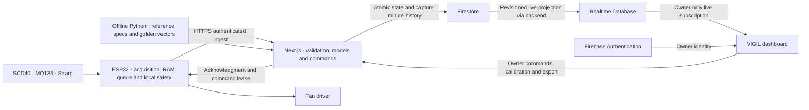

# VIGIL-IIAQ

VIGIL is an undergraduate prototype for observing indoor conditions and controlling ventilation. A NodeMCU-32S reads CO₂, temperature, humidity, gas response and optical dust response. An owner dashboard presents the readings, approximate occupancy, forecasts and the actual fan state.

**Current state.** Firmware, backend, calibration and dashboard are implemented. The automated and browser evidence is summarized below. Deployment, target compilation and supervised physical validation remain open. The repository uses a four-hour-per-day experimental planning scenario.

## Architecture



The device preserves capture sequence, uptime and boot identity. A bounded RAM queue supports reconnect replay. Firestore commits the cursor, model state and history together, then RTDB publishes a revisioned live view. Retries repair projection failures. An older replay cannot issue a live fan lease. The browser uses Firebase Auth and presents backend results. Python is an offline tool. [Firmware wire contract](firmware/README.md) · [Backend durability and API](web/README.md)

## Start here

| Task | Guide |
|---|---|
| Install and run on Windows 11 | [Windows PowerShell and software verification](docs/windows_setup.md) |
| Prepare an isolated Firebase project and Vercel configuration | [Cloud setup and deployment runbook](docs/cloud_setup.md) |
| Identify wiring, compile and safely provision the ESP32 | [Hardware, Arduino IDE and TLS](docs/esp32_setup.md) |
| Validate the complete device-to-dashboard path | [Ordered integration checklist](docs/integration_checklist.md) |
| Collect and assess real experimental evidence | [Lab validation plan](docs/experimental_validation.md) |
| Diagnose a failed setup or reading | [Troubleshooting](docs/troubleshooting.md) |
| Review Phase 6 build attempts and release gates | [Verification record](docs/phase6_verification.md) |

## Hardware and software

Use the classic ESP32 **NodeMCU-32S**, a supported USB data cable, Sensirion SCD40, the project's MQ135 measurement circuit, Sharp GP2Y1010AU0F optical sensor and the existing fan-driver assembly. The original sketch documents GPIOs, acquisition timing and reconstruction factors. The sensor breakout power rails, physical driver schematic and component ratings require review of the actual assembly before applying power. A scope or logic analyzer and a safe indicator load support bench verification. [Wiring and source lines](docs/esp32_setup.md)

The documented development setup uses Git, Windows PowerShell, Node.js 24 with npm, Python 3.12 with NumPy, and Arduino IDE 2 with ESP32 core 2.0.17. Linux/WSL with g++ supports the host firmware tests and C++ golden-vector oracle. A browser and internet access are required for the Firebase workflow. The web build bundles Syne Regular from the repository. Cloud use requires an authorized Firebase project and a Vercel account. [Versions and commands](docs/windows_setup.md)

## What VIGIL measures

| Sensor | Measurement and model |
|---|---|
| **SCD40** | Supplies measured CO₂ in ppm, temperature and relative humidity. The imported Ridge model combines the current CO₂ window mean relative to the empty-room reference and its least-squares slope. It clips the estimate and reports an even-rounded approximate count. Calibration changes only the environmental baseline. |
| **MQ135** | Supplies raw ADC, reconstructed voltage and sensor resistance. The model compares a log-resistance response against an anchor-relative quadratic temperature/humidity correction. Robust residual scoring, positive-score EWMA and three-of-five confirmation identify an unusual response. Calibration updates the anchor with the owner-approved median method. |
| **Sharp GP2Y1010AU0F** | Uses timed LED pulses and calibrated ADC conversion to measure optical response. Each aggregate includes ON, OFF, difference and pulse diagnostics. A rolling median of 30 valid ON aggregates feeds provisional response bands and a persistent-high gate. Calibration can update the median and scaled MAD without changing acquisition. |

The imported coefficients, original firmware constants and provisional experiments are recorded with provenance. The potentially synthetic occupancy trace stays outside measured training and accuracy validation. [Source audit](docs/phase0_report.md) · [Model specs and numerical comparison](training/comparison.md) · [Calibration gates](docs/phase4_calibration.md)

### Forecasting and ventilation

The backend predicts CO₂ ten minutes ahead using persistence, a linear projection from the firmware feature window, and a reconstructed median pairwise slope over the recent 61 fresh samples. One observed target timestamp pairs with a stored origin. MAE, RMSE and signed bias use shared matched origins only. The legacy robust estimator and off-grid matching tolerance remain unknown. Exact-time matching can produce very few pairs on real hardware. [Forecast reconstruction](training/comparison.md) · [Backend metrics and contract](web/README.md)

In Auto, the backend requests ventilation at the original **1,000 ppm** start threshold or after three distinct preventive votes. A preventive vote requires at least **850 ppm**, a rise of at least **5 ppm/min** and a linear forecast reaching **1,000 ppm**. Minimum run and recovery use **120 s** and **180 s continuously below 750 ppm**. Freshen uses a short **10 s** authorization. Off changes the remote request. The device forces OFF when CO₂ is invalid or older than **15 s**, and fresh CO₂ at or above **1,000 ppm** can start a local latch even when Off is requested. The UI shows actual device state separately. [Original policy constants](inputs/code/VIGIL_Phase3_Fixed.ino:23) · [Local safety table](firmware/README.md#safety-decision-table)

### Calibration and versions

The owner confirms room conditions before starting a calibration. The backend records warm-up, a measured window and continuity/stability gates. Passing activates a version atomically in Firestore. Failed and aborted sessions preserve the working version. The owner can confirm a restore from the Settings screen. The next capture rebuilds temporal model state. CSV export includes timing and raw evidence; unavailable legacy columns stay blank. [Calibration lifecycle and restore](docs/phase4_calibration.md)

## Repository structure

```text
/
├── README.md, AGENTS.md, .env.example, .gitignore
├── inputs/                 Immutable firmware, model header, CSVs, brand, references and mirrored source
├── training/               Python generators, specs/, golden.json, candidate comparisons and tests
├── firmware/
│   ├── VigilV2/            Arduino sketch, acquisition, networking, command parser and local control
│   ├── tests/              C++ and Python host harnesses
│   └── README.md           Wiring parity, queue and HTTPS contract
├── web/
│   ├── app/                Next.js pages and authenticated API routes
│   ├── ui/                 Syne interface, live provider, display bands, charts and owner controls
│   ├── src/                Ingest, Firebase adapter, inference, calibration and CSV export
│   ├── public/brand/       Copies of the supplied assets
│   ├── tests/              Vitest suites and isolated browser harness
│   ├── firebase.json, database.rules.json, firestore.rules, firestore.indexes.json
│   └── README.md           Backend contract and capacity
└── docs/                   Phase reports, screenshots and Phase 6 runbooks
```

## Verification and limits

| Evidence | Status |
|---|---|
| Phase 1 model fixtures | Five offline tests pass. Golden vectors are synthetic and check numerical agreement only. |
| Backend and UI | 45 Vitest cases cover golden vectors, authorization, sequencing, replay, calibration and display boundaries with synthetic data and mocked transactions. |
| Browser | Chromium renders desktop, tablet and mobile screens using labelled fixtures. The redesign report includes all six screens at desktop and mobile sizes. |
| Production build | The ordinary Next.js production build passes with the bundled Syne Regular font. |
| ESP32 and cloud | Firmware host checks cover control, queue, replies and acquisition gate parity. The target build, real Wi-Fi, TLS, Firebase, Vercel and physical integration remain unverified. |
| Experimental scope | Sensor categories describe prototype observations. Occupancy is approximate, MQ135 and Sharp response are relative, and calibration gates remain provisional. YouTube playback remains unverified. |

The supplied logo and Roger Waters photograph require rights confirmation before public use. Plan quota and retention before any continuous operation. [Phase 6 verification](docs/phase6_verification.md) · [Redesign and screenshots](docs/interface_redesign.md) · [Brand kit provenance](inputs/brand/README.txt)
